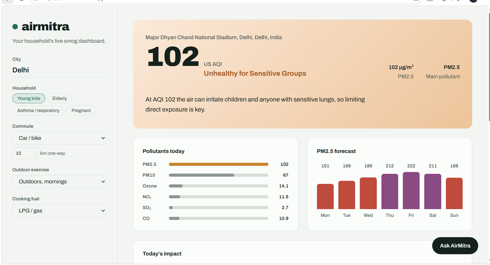
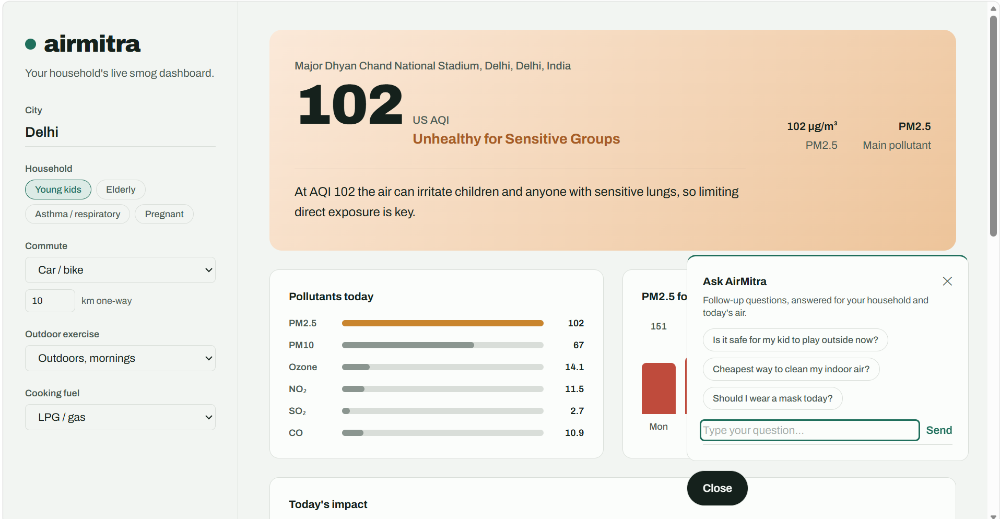

# 🌬️ AirMitra — Your family's winter-smog coach

[](https://github.com/shubhgithubrit/airmitra/actions/workflows/ci.yml)

**AirMitra** is a GenAI-powered assistant that helps families and communities navigate severe
winter smog and urban air pollution. You tell it your **city**, **who's in your household**, and
your **daily habits** — it reads **today's live air quality** and generates a personalized
**"Today's Smog Plan"**: low-emission daily routines, indoor air-quality hacks, and sustainable
alternatives — and it makes the **direct impact of every choice crystal clear**.

> Built for the GenAI winter-smog / urban air-pollution challenge.

| Dashboard | Ask AirMitra |
|---|---|
|  |  |

---

## ✨ What it does (maps to the challenge)

| Challenge requirement | In AirMitra |
|---|---|
| Low-emission daily routines | "Daily routines" cards, tailored to AQI + commute + exercise habits |
| Indoor air-quality hacks | "Indoor air hacks" cards (DIY HEPA box-fan, sealing rooms, cooking fuel, etc.) |
| Sustainable alternatives | "Sustainable swaps" cards (transit, cleaner cooking, etc.) |
| Explain the direct impact | Every tip has an **Impact** line; plus a live **Impact Meter** (cigarettes-equivalent exposure + kg CO₂ saved) |
| Tailored to location | Live AQI fetched for the user's **city** |
| Tailored to lifestyle | Advice changes for kids / elderly / asthma / pregnancy, commute mode, exercise timing, cooking fuel |

## 🤖 Where GenAI is used (and how)

- **Groq — GPT-OSS 120B** is the reasoning brain (free tier, OpenAI-SDK-compatible).
- The server builds a structured prompt from the **live air-quality reading** + the **household
  profile** and asks the model to generate the full personalized plan as **structured JSON**
  (`response_format: json_object`), which the UI renders as cards. → see
  [`lib/ai.ts`](lib/ai.ts) (`generatePlan`).
- A **follow-up chat** ("Ask AirMitra") uses the same model with the same live context in the
  system prompt, so answers stay grounded in the user's situation. → [`lib/ai.ts`](lib/ai.ts)
  (`answerFollowUp`), [`app/api/chat/route.ts`](app/api/chat/route.ts).
- Live air-quality data comes from the **WAQI API** (real, not mocked). → [`lib/aqi.ts`](lib/aqi.ts)
- Impact numbers (cigarettes, CO₂) are computed **deterministically** from the data so they're
  trustworthy, not hallucinated. → [`lib/impact.ts`](lib/impact.ts)

## 🏗️ Tech stack

- **Next.js (App Router) + TypeScript + Tailwind CSS** — one app, one deploy.
- **Groq (GPT-OSS 120B)** via the official `openai` SDK's `OpenAI` client, pointed at Groq's API.
- **WAQI (aqicn.org)** for live AQI.
- Deployed on **Vercel**.

## 🧱 Architecture

```
app/
  page.tsx            — dashboard (client component), wires profile state to usePlan()
  hooks/usePlan.ts     — debounced fetch of /api/plan, abort-on-change, min-loading-time UX
  components/          — presentational cards (AQI, forecast, pollutants, impact, plan, chat)
  api/plan/route.ts    — validates profile, fetches live AQI, asks the model for a plan
  api/chat/route.ts    — follow-up chat, grounded in the same AQI + profile context
lib/
  aqi.ts               — WAQI fetch + short-lived cache
  ai.ts                — Groq prompt construction (generatePlan, answerFollowUp)
  impact.ts            — deterministic cigarette/CO₂ math (never hallucinated)
  validate.ts          — whitelists/bounds every field from untrusted request bodies
  rateLimit.ts         — in-memory fixed-window limiter for the API routes
```

Both API routes are the only place secrets (`GROQ_API_KEY`, `WAQI_TOKEN`) are read — the client
never sees them. Request bodies are revalidated server-side (`lib/validate.ts`) even though the UI
only ever sends well-formed data, since the routes are public endpoints.

## ✅ Testing

```bash
npm test              # run the suite once
npm run test:watch    # watch mode
npm run test:coverage # with a coverage report
```

84 tests (Vitest + React Testing Library) cover the pure logic in `lib/` and every component in
`app/components/`, including network-error and edge-case paths. CI (see badge above) runs lint,
a full typecheck, the test suite, and a production build on every push.

## 🚀 Run locally

```bash
npm install
cp .env.example .env.local   # then fill in your keys
npm run dev                  # http://localhost:3000
```

### Required environment variables

See [`.env.example`](.env.example):

- `GROQ_API_KEY`, `GROQ_MODEL` — free from <https://console.groq.com>
- `WAQI_TOKEN` — free from <https://aqicn.org/data-platform/token/>

## ☁️ Deploy (Vercel)

1. Push this repo to GitHub (public).
2. Import it at [vercel.com/new](https://vercel.com/new).
3. Add the environment variables above in **Project → Settings → Environment Variables**.
4. Deploy. The live URL is your submission's "Project Deployed Link".

## 📐 Impact methodology

- **PM2.5 → cigarettes:** ~22 µg/m³ of PM2.5 over 24h ≈ 1 cigarette (Berkeley Earth rule of thumb).
- **Transport CO₂:** petrol car ≈ 0.17 kg CO₂/km; public transit per-passenger marginal ≈ 0.
- When a station doesn't report raw PM2.5, it's estimated from the US AQI breakpoints.

_Advice is informational and not a substitute for medical guidance._
